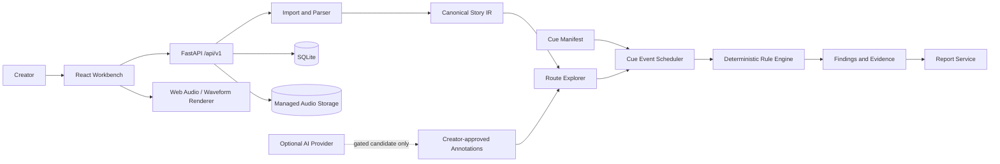

# ARCHITECTURE.md — System Architecture

## 1. Architectural approach

Use a **modular monolith**. Do not create microservices for the MVP. Frontend and backend communicate through versioned JSON APIs. Backend/domain services are authoritative for parsing, route simulation, cue scheduling, validation and report generation. React components are presentation and interaction layers only.

## 2. Recommended stack

### Frontend
- React + TypeScript + Vite.
- React Router for seven independent workspaces.
- Tailwind CSS or CSS Modules; one canonical token source in `styles/tokens.css`.
- `@xyflow/react` for interactive Story Graph.
- Web Audio API for playback; WaveSurfer or a typed canvas renderer for waveform from decoded bytes.
- TanStack Query for server state/cache.
- Zustand for transient shared route/passage/selection/playback UI state only.
- Zod for API boundary validation.
- Lucide React for outline icons.
- Vitest + React Testing Library; Playwright for critical user journeys where feasible.

### Backend
- Python 3.11+.
- FastAPI + Pydantic v2.
- NetworkX for graph utilities if useful and permitted; keep algorithms behind service interfaces.
- SQLAlchemy 2.x + SQLite for local persistence.
- Alembic only when migrations are genuinely required.
- NumPy/SciPy only for actual signal analysis needs.
- `google-genai` only after the compliance gate authorises live-sprint/AI integration.
- Pytest + HTTPX.

## 3. High-level flow



## 4. Data flow

1. Validate uploaded story file.
2. Parse supported source syntax while preserving offsets and diagnostics.
3. Compile canonical Story IR and graph.
4. Produce candidate annotations only when allowed; validate evidence and require creator approval.
5. Bind uploaded audio assets and cue manifest.
6. Explore routes while carrying supported variables/facts.
7. Emit cue-trigger events at exact simulation points.
8. Evaluate deterministic rules against state at each trigger.
9. Persist run, finding, state snapshot, source evidence and route trace.
10. Present shared state across Graph, Inspector, Route Lab, Narrative Map and Validation Centre.

## 5. Backend module boundaries

```text
backend/app/
  main.py
  core/                  # settings, logging, error envelopes
  api/routes/            # HTTP adapters only
  domain/                # enums, typed entities and value objects
  ingestion/             # file checks, lexer, parser, source map
  compiler/              # supported syntax and compile orchestration
  ir/                    # canonical story representation
  graph/                  # directed graph and route/state explorer
  narrative/              # provider interface, evidence checks, approval
  audio/                  # asset service, cue model, scheduler, metadata
  rules/                  # pure deterministic evaluators
  reporting/              # report serializer/export
  persistence/            # SQLAlchemy tables and repositories
  storage/                # managed local storage adapter
  tests/
```

Keep `rules/` independent of FastAPI, SQLAlchemy and AI SDKs. Each evaluator accepts typed inputs and returns typed findings. HTTP routes call application services; they do not contain core algorithms.

## 6. Frontend module boundaries

```text
frontend/src/
  app/                    # App, router, providers
  layouts/                # AppShell, Sidebar, Topbar, AudioTransport
  features/
    overview/
    story-graph/
    narrative-map/
    cue-library/
    route-lab/
    validation-centre/
    reports/
    project-import/
  components/             # panels, graph nodes, tables, waveform, dialogs
  services/               # typed API clients; fetch is not in view components
  stores/                 # project context, workspace, transient playback
  types/                  # canonical client contracts
  styles/                 # tokens, globals, accessibility utilities
  test/
```

## 7. Shared state ownership

Minimum cross-workspace state:

- `activeProjectId`
- `activeStoryVersionId`
- `activeWorkspace`
- `selectedRouteId`
- `selectedPassageId`
- `selectedFindingId`
- `activeSimulationId`
- `activeValidationRunId`
- playback state: route, current time, transport status, selected audio layers, loaded asset IDs
- `demoMode`

TanStack Query owns server data and cache invalidation. Zustand owns transient selection/transport state only. Avoid copied mutable route/finding entities in components. Derived data (route path, selected passage object, filtered finding count, timeline segments) is computed from canonical entities and selected IDs.

A route change must update graph edge highlighting, route sequence, inspector route context, Route Lab and timeline. A passage selection must update selected graph node, inspector and timeline segment. Clicking a finding must set route/passage/finding consistently.

## 8. Route simulation event order — domain invariant

For each passage entry:

1. Record passage entry and inherited/pre-entry state.
2. Evaluate passage-entry cue triggers against inherited state.
3. Record cue-trigger events and required-fact mismatches.
4. Apply supported state mutations and approved narrative events in source order.
5. Evaluate narrative-event cue triggers immediately after the event updates state.
6. Evaluate outgoing link guards before selecting the next edge.

This ordering is what reproduces the Air Vent early-theme defect. Do not reorder this flow to make the finding disappear.

## 9. Exploration limits

- Development default: 10,000 states, 500 passage depth; both configurable.
- Detect cycles and report why exploration stops.
- Return `exhaustive`, `bounded` or `incomplete` exactly as justified.
- Unsupported syntax that may affect reachability/state invalidates exhaustive claims for the affected branch.
- Deduplicate using passage ID + normalized supported variables + known facts + active cue state.
- Provide cancellation/time limits for expensive simulations.

## 10. AI boundary

AI is an optional structured-annotation provider, never the validation engine. Do not activate model API calls, prompt tuning, orchestration or inference hooks before the compliance gate permits them. When enabled:

- calls occur on backend only;
- structured Pydantic output is validated;
- passage IDs must exist;
- evidence must match source text;
- intensity must be integer 1–5;
- candidates remain pending until creator approval;
- model ID, prompt version and timestamp are recorded;
- `GEMINI_API_KEY`/other secrets never reach Vite/client bundles.

Fixture mode must work without an API key and be visibly labelled.

## 11. Audio architecture

- Asset service creates managed IDs/storage keys, never accepts arbitrary local paths.
- Verify MIME/content signature, size, decoder and hash.
- Browser waveform is derived from decoded actual media bytes.
- Missing asset: show `Missing asset`/`No audio loaded`; no playable control and no fabricated waveform.
- Cue event route position comes from simulation trace. If route time is unavailable, anchor the event to passage entry and indicate `exact time unavailable`.
- Web Audio scheduling must respect layer, offset, fades, loop, stop policy and overlap intent.
- Playback only after user gesture; handle decode errors and autoplay denial.
- Stop and dispose all active sources on route change/unmount; revoke object URLs.
- The screenshot's 04:32/01:24 are display-fixture values, not evidence of a bundled track or audio duration.

## 12. API and persistence

All endpoints live under `/api/v1`. Pydantic validates boundary payloads; services validate ownership and referential integrity. Use the error envelope in `SCHEMA.md`. SQLAlchemy repositories are isolated from route handlers. SQLite foreign keys must be enabled on every connection.

## 13. Security

Validate upload name, extension, byte size, content signature and decoder. Generate storage keys. Prevent traversal and collision. Treat source text and model outputs as untrusted. Never `eval`, `exec` or run imported content. Do not log secrets, raw audio or full story text by default. Restrict CORS to configured origins. Keep secrets in backend environment variables.

## 14. Development and deployment

Local: frontend Vite dev server, backend Uvicorn, SQLite and managed local storage. Keep frontend/backend run commands independent. Deploy only after local checks pass; HTTPS, CORS and backend-only secrets are required. Cloud deployment is not a prerequisite for local demo.
