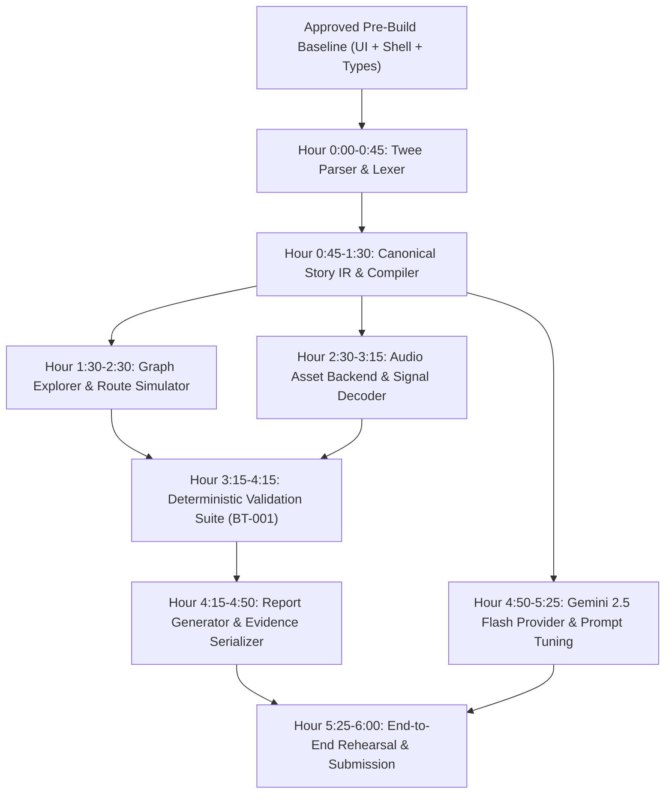

# LIVE_SPRINT_RUNBOOK.md — Six-Hour Live Sprint Execution Plan

**Sprint Date:** 21 November 2026  
**Time Window:** 12:00 PM – 5:45 PM IST (5 hours 45 mins + 15 mins buffer)  
**Track:** Soundscapes & Composition — GeNarrative Clash 2026  
**Objective:** Transform the verified pre-build application baseline into a fully autonomous, end-to-end Narrative Audio QA & Regression Testing Studio by implementing the substantive domain engines, audio decoding pipeline, deterministic rule suite, and live Gemini AI integration.

---

## 1. Sprint Architecture & Dependency Flow



---

## 2. Six-Hour Master Schedule & Time Allocation

| Phase / Milestone | Time (IST) | Duration | Lead | Focus Area | Deliverable |
|---|---|---|---|---|---|
| **M1: Ingestion & Lexer** | 12:00 – 12:45 | 45m | Member B | Twee Harlowe Lexer & Header Parser | `backend/app/ingestion/` |
| **M2: Compiler & IR** | 12:45 – 13:30 | 45m | Member B | Canonical Story IR Compilation | `backend/app/compiler/` & `/ir/` |
| **M3: Graph & Simulation** | 13:30 – 14:30 | 60m | Member B | Directed Graph Traversal & State Simulator | `backend/app/graph/` |
| **M4: Audio Backend** | 14:30 – 15:15 | 45m | Member A | Audio Upload, Storage & Waveform Decoder | `backend/app/audio/` |
| **M5: Rule Engine (BT-001)** | 15:15 – 16:15 | 60m | Shared | 4 Deterministic Rules & Evidence Verification | `backend/app/rules/` |
| **M6: Report Service** | 16:15 – 16:50 | 35m | Member A | Canonical JSON/CSV Report Serialization | `backend/app/reporting/` |
| **M7: Live AI Integration** | 16:50 – 17:25 | 35m | Shared | Gemini 2.5 Flash Structured Annotations | `backend/app/narrative/` |
| **M8: E2E QA & Submission** | 17:25 – 18:00 | 35m | Shared | End-to-End Walkthrough, Demo Video & Push | Live Demo & Portal Push |

---

## 3. Module-by-Module Technical Execution Plans

### Milestone 1: Twee Story Lexer & Parser (12:00 – 12:45)
- **Target Files:**
  - `backend/app/ingestion/lexer.py`
  - `backend/app/ingestion/parser.py`
  - `backend/app/ingestion/source_map.py`
  - `backend/app/tests/test_twee_parser.py`
- **Dependencies:** Standard library (`re`, `hashlib`, `unicodedata`), `backend/app/domain/entities.py`.
- **Interfaces:**
  ```python
  def parse_twee_source(source_text: str, filename: str) -> ParsingResult
  ```
- **Inputs:** Raw UTF-8 `.twee` text file bytes.
- **Outputs:** `ParsingResult` with raw passage blocks, tags, extracted `[[links]]`, `(set:)` macros, Unicode offsets (`source_start`, `source_end`), and 1-based line numbers.
- **Acceptance Criteria:**
  - Computes exact SHA-256 hash of source bytes.
  - Zero-based Unicode code-point offsets match exact characters (no UTF-16 drift).
  - CRLF and LF newlines parse identically.
  - Unknown macros are flagged as `UNSUPPORTED_STORY_SYNTAX` diagnostics rather than crashing.
- **Tests:** `backend/app/tests/test_twee_parser.py` (positive link syntax, unicode offsets, negative controls for malformed headers).

---

### Milestone 2: Canonical Story IR & Compiler (12:45 – 13:30)
- **Target Files:**
  - `backend/app/compiler/story_compiler.py`
  - `backend/app/api/routes/imports.py`
  - `backend/app/tests/test_story_compiler.py`
- **Dependencies:** `app/ingestion`, `app/domain/entities.py`.
- **Interfaces:**
  ```python
  def compile_story_ir(parsing_result: ParsingResult, project_id: str) -> CanonicalStoryIR
  ```
  - HTTP: `POST /api/v1/projects/{project_id}/imports`
- **Inputs:** `ParsingResult` from M1.
- **Outputs:** `StoryVersion` record, `List[Passage]`, `List[StoryEdge]` (with verified target passage IDs and guards), `List[StateMutation]`.
- **Acceptance Criteria:**
  - Resolves links to passage IDs.
  - Flags dangling links (`MISSING_LINK_TARGET`).
  - Flags duplicate passage titles (`DUPLICATE_PASSAGE_TITLE`).
  - Returns HTTP 201 with `StoryVersionEnvelope` or HTTP 422 with `ErrorEnvelope`.
- **Tests:** Unit tests with broken links, duplicate titles, and valid Harlowe branches.

---

### Milestone 3: Directed Graph & Route Simulation Engine (13:30 – 14:30)
- **Target Files:**
  - `backend/app/graph/story_graph.py`
  - `backend/app/graph/route_simulator.py`
  - `backend/app/api/routes/simulation.py`
  - `backend/app/tests/test_route_simulation.py`
- **Dependencies:** `app/compiler`, `app/domain/entities.py`.
- **Interfaces:**
  ```python
  def simulate_routes(story_graph: StoryGraph, cues: List[AudioCue], annotations: List[NarrativeAnnotation], max_depth: int = 500, max_states: int = 10000) -> SimulationRun
  ```
  - HTTP: `POST /api/v1/projects/{project_id}/simulate`
- **Inputs:** `CanonicalStoryIR`, creator cues, approved annotations, budget limits.
- **Outputs:** `SimulationRun` entity with `RouteResult[]`, `RouteTraceStep[]` (carrying `facts_before_entry`, `facts_after_events`), and `CueActivationEvent[]`.
- **Domain Invariant (Strict):**
  1. Record passage entry state.
  2. Evaluate passage-entry cue triggers against inherited state.
  3. Emit cue activation events.
  4. Apply mutations and approved events.
  5. Evaluate narrative-event cues.
  6. Evaluate guards and advance.
- **Acceptance Criteria:**
  - Simulates Route A and Route B faithfully.
  - On Route B, Air Vent inherits `traitor_identity_revealed = false/unknown`.
  - Terminates cycles cleanly within depth/state budget; returns `bounded` or `exhaustive` truthfully.
- **Tests:** Cycle detection test, budget exhaustion test, Route A/B fact isolation test.

---

### Milestone 4: Audio Asset Backend & Waveform Decoder (14:30 – 15:15)
- **Target Files:**
  - `backend/app/audio/asset_service.py`
  - `backend/app/audio/waveform_decoder.py`
  - `backend/app/api/routes/assets.py`
  - `backend/app/tests/test_audio_assets.py`
- **Dependencies:** Standard library (`wave`, `pathlib`), `scipy.io.wavfile` or `mutagen`.
- **Interfaces:**
  ```python
  def store_and_decode_asset(file_stream: BinaryIO, filename: str, project_id: str, media_type: str) -> AudioAsset
  def get_waveform_peaks(storage_key: str, bucket_count: int = 128) -> List[float]
  ```
  - HTTP: `POST /api/v1/projects/{project_id}/assets`, `GET /api/v1/projects/{project_id}/assets/{id}/waveform`
- **Inputs:** Multipart audio file upload.
- **Outputs:** Stored asset file with UUID storage key, measured duration, sample rate, channels, SHA-256 hash, and normalized waveform peak array [0.0, 1.0].
- **Acceptance Criteria:**
  - Enforces 50MB maximum size limit.
  - Sanitizes filenames against path traversal (`../../`).
  - Verifies RIFF/WAV or ID3 header magic bytes.
  - Returns true decoded peaks; never returns synthetic or randomized data.
- **Tests:** Path traversal upload rejection, invalid audio header rejection, real WAV duration measurement.

---

### Milestone 5: Deterministic Validation Suite & BT-001 (15:15 – 16:15)
- **Target Files:**
  - `backend/app/rules/evaluator.py`
  - `backend/app/rules/reveal_protection.py`
  - `backend/app/rules/cue_coverage.py`
  - `backend/app/rules/tension_lifecycle.py`
  - `backend/app/rules/emotional_continuity.py`
  - `backend/app/api/routes/validation.py`
  - `backend/app/tests/test_validation_engine.py`
- **Dependencies:** Pure domain code (`app.domain.entities`). Zero FastAPI or AI SDK dependencies.
- **Interfaces:**
  ```python
  def run_validation_suite(simulation: SimulationRun, cues: List[AudioCue], passages: Dict[str, Passage]) -> ValidationRun
  ```
  - HTTP: `POST /api/v1/projects/{project_id}/validation-runs`
- **Inputs:** `SimulationRun` trace, `AudioCue[]`, `Passage[]`.
- **Outputs:** `ValidationRun` containing `Finding[]` with verified source evidence excerpts, severity, state comparison, and deduplication keys.
- **Acceptance Criteria:**
  - **BT-001 Reproduction:** Dynamically evaluates Route B Air Vent entry where `traitor_identity_revealed` is false, generating `BT-001` with exact explanation and verbatim quote.
  - **Negative Control:** Route A does NOT generate `BT-001`.
  - **Intentional Silence:** Empty layers do not emit false alarms.
  - **Tension Lifecycle:** Legitimate conflict renewal passes cleanly.
- **Tests:** Positive BT-001 generation, negative Route A control, intensity continuity threshold tests.

---

### Milestone 6: Report Generation & Evidence Serialization (16:15 – 16:50)
- **Target Files:**
  - `backend/app/reporting/report_generator.py`
  - `backend/app/api/routes/reports.py`
  - `backend/app/tests/test_reporting.py`
- **Dependencies:** `app/domain/entities.py`, standard library `json`, `csv`.
- **Interfaces:**
  ```python
  def generate_report(run_id: str, project_id: str) -> Dict[str, Any]
  ```
  - HTTP: `GET /api/v1/projects/{project_id}/reports/{run_id}.json`
- **Inputs:** `ValidationRun`, `SimulationRun`, `StoryVersion`, `Project`.
- **Outputs:** Canonical JSON report validating against `schemas/report.schema.json` and CSV export.
- **Acceptance Criteria:**
  - Includes source SHA-256 hash, timestamps, rule tallies, and finding details.
  - Honestly reports `exploration_status` and coverage metrics (`not_evaluated` if unrun).
- **Tests:** JSON Schema validation test, CSV formatting test.

---

### Milestone 7: Live AI Integration (Gemini 2.5 Flash) (16:50 – 17:25)
- **Target Files:**
  - `backend/app/narrative/gemini_provider.py`
  - `backend/app/narrative/prompt_templates.py`
  - `backend/app/api/routes/annotations.py`
  - `backend/app/tests/test_gemini_provider.py`
- **Dependencies:** `google-genai` SDK, `GEMINI_API_KEY` backend environment variable.
- **Interfaces:**
  ```python
  def propose_narrative_annotations(passage: Passage) -> List[NarrativeAnnotation]
  ```
- **Inputs:** Passage text.
- **Outputs:** Proposed structured candidate annotations with mood, intensity (1–5), and narrative events.
- **Acceptance Criteria:**
  - Output is strictly validated with Pydantic; invalid responses rejected.
  - Candidate annotations remain in `pending` status until human approval in Narrative Map.
  - Credentials remain strictly backend-only.
- **Tests:** Mocked provider test for structured extraction, timeout/rate-limit error handling test.

---

### Milestone 8: End-to-End Integration, Demonstration & Submission (17:25 – 18:00)
- **Tasks:**
  - Connect frontend TanStack Query hooks to live backend endpoints.
  - Run full E2E walkthrough script.
  - Verify all 40 frontend and 11+ backend tests pass concurrently.
  - Record 3-minute demonstration video showing genuine execution.
  - Final Git tag: `v1.0.0-live-sprint-final`.
  - Submit repository and video link on official Devfolio portal before 18:00 IST.

---

## 4. End-to-End Live Demonstration Script

The live demonstration will prove real execution:
1. **Story Upload:** Creator uploads `the_last_signal.twee` in the workbench. Backend parser compiles the story into 5 passages and 5 transitions.
2. **Graph Visualization:** Story Graph workspace renders the compiled DAG.
3. **Audio Cue Assignment:** Creator configures `traitor_theme.wav` on the Music layer triggered by Air Vent entry with required fact `traitor_identity_revealed == true`.
4. **Route Simulation:** Route Lab executes route exploration across Route A and Route B.
5. **Deterministic Validation:** Validation Centre executes the rule suite.
6. **Defect Surfacing (BT-001):** The workbench flags `BT-001` on Route B:
   - *Expected State:* `traitor_identity_revealed: true`
   - *Actual State:* `traitor_identity_revealed: false`
   - *Evidence:* Verbatim excerpt from passage P-003.
7. **Remediation:** Creator adjusts the cue trigger to passage P-004 (Server Vault) where identity is revealed.
8. **Regression Verification:** Re-running validation clears BT-001, proving regression testing capability.
9. **Export Report:** Generates and downloads the reproducible JSON audit report.

---

## 5. Organizer Clarification Decision Branches

- **Branch A (All Substantive Engines Cleared for Pre-Build):** If organizers respond that parser and rules are permitted as boilerplate, execute Milestones 1–5 ahead of sprint day and use sprint exclusively for audio synthesis, Gemini prompt tuning, and polished Polish.
- **Branch B (Strict 50/50 Example Interpretation — Current Default):** Follow this 6-hour runbook exactly as scheduled on 21 November 2026.
- **Branch C (AI Integration Offline Fallback):** If internet access or Gemini API rate limits fail during the sprint, fall back to cached candidate annotation fixtures while demonstrating fully operational deterministic validation.
